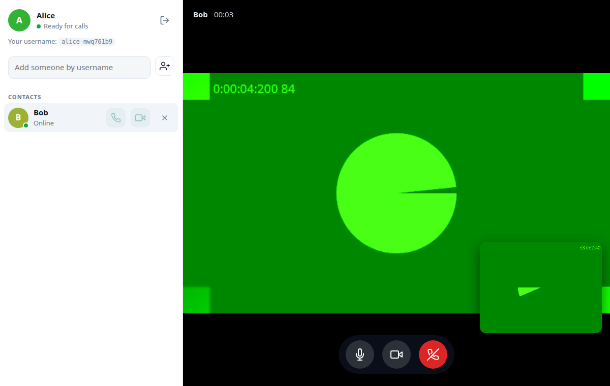
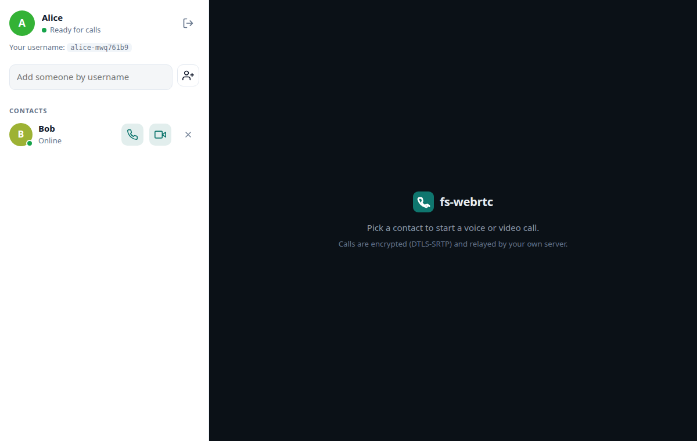
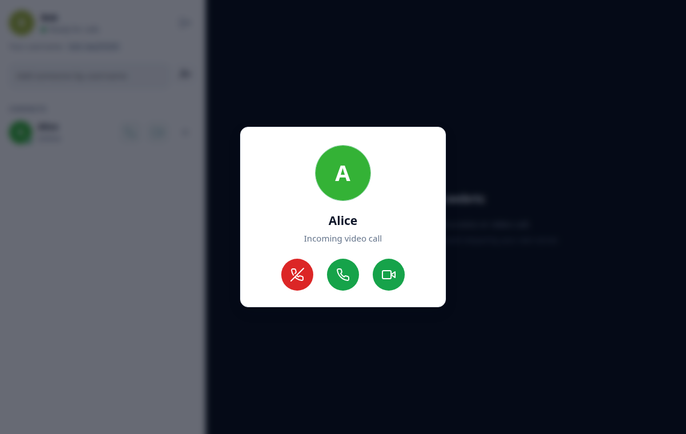
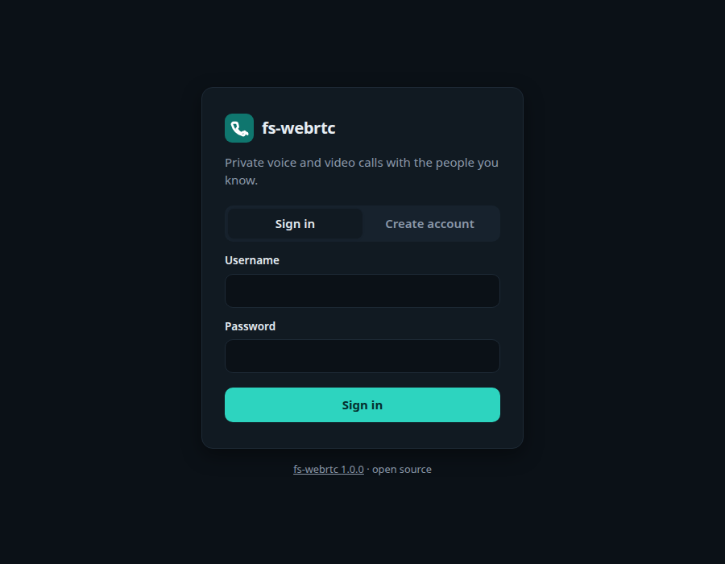
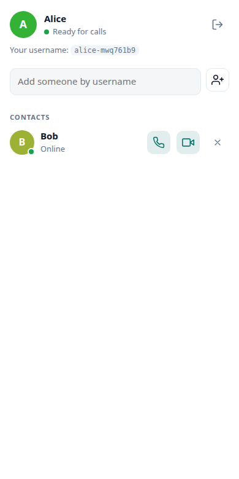
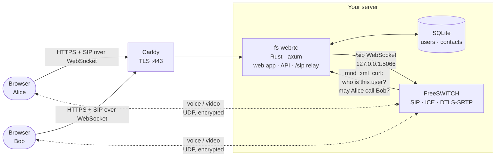

<div align="center">


# fs-webrtc

**Your own private calling app.** Self-hosted voice and video calls between the people you
choose, in any modern browser, powered by [FreeSWITCH](https://signalwire.com/freeswitch) and WebRTC.
One command to install, nothing to install for the people you call.

[](https://github.com/101t/fs-webrtc/actions/workflows/ci.yml)
[](https://github.com/101t/fs-webrtc/releases)


[](LICENSE)



</div>

```bash
curl -fsSL https://raw.githubusercontent.com/101t/fs-webrtc/master/install.sh | sh
```

---

## Why fs-webrtc

Calling apps are either someone else's servers or a telephony project you have to assemble
yourself. fs-webrtc is the small, finished thing in between: a web app your family, friends or
team open in the browser, running on a server you control.

| | |
|---|---|
| 📞 **Voice & video calls** | One-to-one, HD video, mute, camera toggle, ringing and ringback, missed-call notices. |
| 🤝 **Contacts, not strangers** | Add people by username; once they add you back you can call each other. Nobody else can ring you, and the rule is enforced by FreeSWITCH itself, not only the UI. |
| 🔒 **Private by design** | Media is encrypted (DTLS-SRTP) and relayed by *your* server, so the other side never sees your IP. No trackers, no third-party scripts. |
| 🌐 **Nothing to install** | Runs in any modern browser with WebRTC, on desktop and phone. |
| 🚀 **One-command install** | Docker Compose stack with automatic HTTPS (Caddy + Let's Encrypt). Upgrades are one command too. |
| 🧩 **Built on FreeSWITCH** | A real telephony engine, not a toy signalling server; a solid base for features to come. |
| 🪶 **Small and fast** | A single Rust binary with SQLite. Runs on the smallest VPS. |

<table>
  <tr>
    <td></td>
    <td></td>
  </tr>
  <tr>
    <td></td>
    <td align="center"></td>
  </tr>
</table>

## Quick start

You need a Linux server with [Docker](https://docs.docker.com/engine/install/) and a domain
name pointing at it (an IP address works too, with a self-signed certificate).

```bash
curl -fsSL https://raw.githubusercontent.com/101t/fs-webrtc/master/install.sh | sh
```

The installer asks for your domain, generates secrets into `fs-webrtc/.env`, and starts
fs-webrtc, FreeSWITCH and Caddy. Then:

1. **Open the firewall:** TCP 80, 443 and UDP 16384-16584 (`ufw allow 80,443/tcp && ufw allow 16384:16584/udp`).
2. **Open `https://your-domain`**, create your account and share the address.
3. **Add contacts** by username. When they add you back, the call buttons appear.
4. **Lock it down** once everyone has joined: `FSW_SIGNUP=false` in `.env`, then `docker compose up -d`.
   Or set `FSW_INVITE_CODE` from the start.

<details>
<summary><b>Manual install with Docker Compose</b></summary>

```bash
git clone https://github.com/101t/fs-webrtc && cd fs-webrtc
cp .env.example .env
#  FSW_DOMAIN=call.example.com
#  FSW_FREESWITCH_SECRET=$(openssl rand -hex 32)
docker compose up -d          # --build to build from source
```

</details>

Behind nginx, on a LAN without internet, without Docker, or next to an existing FreeSWITCH:
see the **[deployment guide](docs/deployment.md)**.

## How it works



* **One origin.** fs-webrtc serves the React app and the REST API, and relays SIP-over-WebSocket
  at `/sip` to FreeSWITCH on loopback. One certificate, one port; FreeSWITCH's signalling is
  never exposed.
* **FreeSWITCH asks, fs-webrtc decides.** Through mod_xml_curl, FreeSWITCH looks up every SIP
  account (only real users exist, each with a random server-generated SIP password) and every
  call route (only mutual contacts are bridged; everything else gets `404`).
* **Media through your server.** Browsers negotiate ICE and DTLS-SRTP with FreeSWITCH, which
  bridges the two legs. Works across NATs without exposing users' addresses to each other.
* **Browser side:** React 19 + TypeScript + [JsSIP](https://jssip.net), with ring tones
  synthesized by Web Audio.

## Configuration

Settings live in `.env` next to `docker-compose.yml`. Apply changes with `docker compose up -d`.

| Variable | Default | |
|---|---|---|
| `FSW_DOMAIN` | **required** | Domain (or IP) of the site; Caddy gets its certificate. |
| `FSW_FREESWITCH_SECRET` | **required** | Shared secret between fs-webrtc and FreeSWITCH, 32+ chars (`openssl rand -hex 32`). |
| `FSW_SIGNUP` | `true` | Allow creating accounts. |
| `FSW_INVITE_CODE` | *(none)* | When set, creating an account requires this code. |
| `FSW_EXT_IP` | STUN discovery | Public IP FreeSWITCH announces for media. Set it on LAN-only setups. |
| `FSW_ICE_SERVERS` | `stun:stun.l.google.com:19302` | STUN/TURN URLs for browsers, comma-separated. |
| `FSW_TURN_USERNAME`, `FSW_TURN_PASSWORD` | *(none)* | Credentials for the `turn:` URLs ([TURN setup](docs/deployment.md#nat-and-media)). |
| `FSW_VERSION` | `latest` | Image tag to run, e.g. `1.0.0`. |
| `FSW_LOG_JSON` | `true` in Docker | JSON log lines. Level via `RUST_LOG`. |
| `FSW_LISTEN` | `0.0.0.0:8090` | Server address (Compose: `127.0.0.1:8090`). |
| `FSW_DATABASE_URL` | `sqlite://fs-webrtc.db` | SQLite database (Docker: in the `fsw-data` volume). |
| `FSW_FREESWITCH_WS` | `ws://127.0.0.1:5066` | FreeSWITCH SIP WebSocket that `/sip` relays to. |
| `FSW_WEB_DIR` | `web/dist` | Built web app (Docker: bundled). |

Every server setting is also a CLI flag: `fs-webrtc --help`.

## Security and privacy

* **No default credentials anywhere.** The shipped FreeSWITCH config has no demo users, no
  default passwords and no route to the phone network. The service refuses to start with a
  weak shared secret.
* **Passwords** are hashed with argon2id; sessions are random 256-bit tokens stored as SHA-256.
  Logins take the same time whether or not the user exists, and an account locks for 15 minutes
  after 5 wrong passwords. Changing your password signs out your other devices and replaces your
  SIP password.
* **Only mutual contacts can call.** Checked by FreeSWITCH's dialplan on every call, via the server.
* **Nothing reaches FreeSWITCH unvalidated.** Usernames are a strict allow-list before they touch
  XML or a dial string; display names never do.
* **Hardened web app:** strict Content-Security-Policy, no third-party scripts or fonts, `no-referrer`,
  clickjacking protection. The only outside service is the STUN server in `FSW_ICE_SERVERS`;
  point it at your own if you prefer.
* **Not end-to-end encrypted.** Media is encrypted on the wire but decrypted by your FreeSWITCH
  to relay it. That is the trade-off for hiding participants' IPs and working through any NAT;
  run it on a server you trust.

Report vulnerabilities privately, see [SECURITY.md](SECURITY.md).

## API

Everything the web app does goes through a documented REST API, so you can script it or build
another client. Interactive docs: **`https://your-domain/docs`**, spec at `/openapi.json`.

| Method | Path | |
|---|---|---|
| `GET` | `/health` | Liveness + FreeSWITCH reachability |
| `GET` | `/api/v1/info` | Version and sign-up mode |
| `POST` | `/api/v1/auth/register` | Create an account → session token |
| `POST` | `/api/v1/auth/login` | Sign in → session token |
| `POST` | `/api/v1/auth/logout` | End the session |
| `GET` | `/api/v1/me` | Profile and SIP credentials |
| `PUT` | `/api/v1/me/password` | Change password (signs out other sessions) |
| `DELETE` | `/api/v1/me` | Delete the account |
| `GET` | `/api/v1/contacts` | Contacts and requests, with online status |
| `POST` | `/api/v1/contacts` | Send or accept a contact request |
| `DELETE` | `/api/v1/contacts/{username}` | Remove, cancel or decline |

## Troubleshooting

| Symptom | Fix |
|---|---|
| "Calls need a secure connection" | Open the site over `https://`. Browsers only allow camera and microphone on HTTPS (or localhost). |
| Status stays "Connecting…" | `curl https://your-domain/health` should show `"freeswitch_reachable": true`. Check `docker compose logs freeswitch`. |
| Call connects but no audio/video | UDP 16384-16584 is blocked or `FSW_EXT_IP` is wrong. See [NAT and media](docs/deployment.md#nat-and-media). |
| No HTTPS certificate | DNS must point at the server and TCP 80/443 must be open; see `docker compose logs caddy`. |
| Call buttons greyed out | You are already in a call, or the contact has not added you back yet. |

## Development

```bash
make            # list all targets
make check      # fmt + clippy + tests + web type-check/build, exactly what CI runs
make up         # the full stack from source via docker compose
make run        # server on :8090 with settings from .env
make web-dev    # web app with hot reload on :5173
```

| | |
|---|---|
| [`src/api/`](src/api) | REST API: accounts, sessions, contacts, validation, OpenAPI |
| [`src/freeswitch.rs`](src/freeswitch.rs) | mod_xml_curl directory and dialplan, `/sip` WebSocket relay |
| [`web/src/phone.ts`](web/src/phone.ts) | JsSIP user agent and call state |
| [`web/src/`](web/src) | React UI |
| [`contrib/freeswitch/freeswitch.xml`](contrib/freeswitch/freeswitch.xml) | Complete FreeSWITCH configuration |

See [CONTRIBUTING.md](CONTRIBUTING.md). Ideas that would make great contributions: group calls
(FreeSWITCH conference), text chat (SIP MESSAGE), push notifications and an installable PWA,
translations.

## Releases

Versions follow [SemVer](https://semver.org) and every release is a `vX.Y.Z` git tag.

```bash
# 1. move the "Unreleased" notes in CHANGELOG.md under "## [1.1.0] - 2026-12-01" and commit
make release-minor            # or release-patch / release-major / release VERSION=1.1.0
git push origin HEAD v1.1.0   # 2. publishing starts here
```

`make release` refuses to run with uncommitted changes, an existing tag, or a missing CHANGELOG
section. It bumps `Cargo.toml`, runs the full check, then commits and tags. The pushed tag runs
[`release.yml`](.github/workflows/release.yml), which:

1. verifies the tag matches `Cargo.toml` and runs the full check;
2. pushes `ghcr.io/101t/fs-webrtc` tagged `1.1.0`, `1.1`, `1` and `latest`;
3. builds a static x86_64 Linux binary (musl) bundled with the web app, with a SHA-256 checksum;
4. publishes a GitHub Release with the CHANGELOG section as notes and the binary attached.

## License

[MIT](LICENSE). Built on the shoulders of [FreeSWITCH](https://github.com/signalwire/freeswitch),
[JsSIP](https://github.com/versatica/JsSIP), [axum](https://github.com/tokio-rs/axum) and
[React](https://react.dev).
